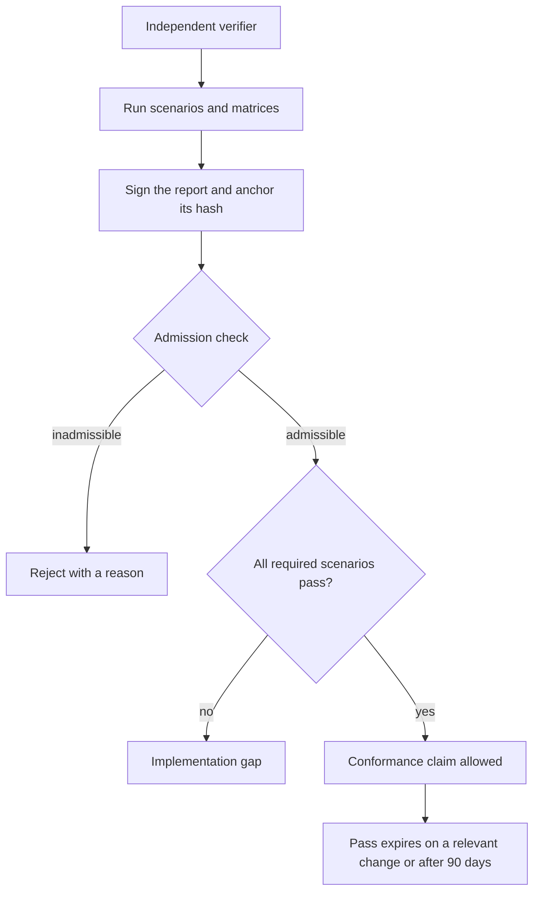

<!-- Generated from docs/src/content/docs. Do not edit directly. -->

# Conformance

*What must be proven, who may verify it, and when a report is admissible.*

Conformance is independent evidence that an implementation still matches the
specification. A successful compile or a scaffold smoke test is not conformance.

## The conformance path

Independence is checked before the run. The sections below list the scenarios,
matrices, verifier rules, and admissibility requirements.

## What conformance is

Conformance uses typed scenarios and matrices, a distinct verifier, a signed
write-once report, and an admission check.

## Core scenarios

- A fresh scaffold: valid descriptor, six runnable commands, successful
  onboarding, loading dashboard.
- An order lifecycle with independent assessment and completion evidence.
- Question blocking, answers, changed-answer revalidation, and successors.
- Restart recovery, launch-gap adoption where supported, duplicate-session
  containment, and no duplicate work. Reference-only adapters must block and
  escalate without launching.
- Confirmed, failed, and unconfirmed cancellation with preservation.
- Budget reservation, delayed usage, priority admission, and overrun stop.
- Plan conflict pause, merge, revalidation, and resume.
- Per-writing-step isolation, pinned prerequisites, and cleanup after
  preservation.
- Job capacity, priority, caching, retries, cancellation, recovery, and
  local-remote parity.
- Wiring validation, repair, rollback, outage classification, and idempotency.
- Duplicate requests, version conflicts, late outcomes, and late results.
- Evidence manifests, redaction, retention, tombstones, and secrets.

Additional required areas include status observability and cannot-start
reasons, graceful shutdown, onboarding states and decision categories,
credential references, configuration change restoration, adoption,
stall detection, deferred and partial delivery, the delivery matrix, the
recovery matrix, the observability matrix, the authorization matrix, the lease
matrix, adoption mapping and conformance, and unmerged-prerequisite
reconciliation.

## Typed matrices

A matrix cell is reported separately and cannot be certified by a summary
verdict. A cell that never reaches its condition is not passed.

- **Harness recovery** — harness × account kind × discovery mode × fault.
- **Budget** — per-attempt, cumulative, delayed, out-of-order, duplicate,
  restart, reset, provider ceiling, budget-unknown, unresolved exposure,
  throttling, exhaustion, paid fallback.
- **Recovery** — crash points derived from the durability order.
- **Delivery** — target kind × fault × outcome.
- **Observability** — fresh/fault pairs on the same fact.
- **Authorization** — positive and denial per operation row.
- **Lease** — target and overlap lease lifecycle.
- **Adoption** — dispositions, provenance, foreign sessions, imported-order
  lineage, crash-mid-import.
- **Verification** — verifier independence, report integrity, expiry, delta,
  admission.

## The verifier

The verifier is a distinct authenticated principal, not merely a new session.

The excluded set is recorded before the run:

- scaffold author;
- descriptor and configuration author;
- onboarding author;
- plan author;
- every required implementer;
- the assessor of the same steps;
- delivery owner, merger, integrator.

The verifier records its signed context, session and attempt identity, and the
pinned clean revision it observed.

Verification grants cover running conformance and appending one report. The
verifier may not alter an existing report, write implementation code, or write
configuration. An external principal may verify if accepted by the project auth
service. If no qualified independent principal exists, conformance stays
blocked. The engineer cannot waive independence.

## Report admissibility

A report records:

- checklist version;
- specification version;
- implementation version;
- descriptor version;
- claimed-capability inventory;
- environment fingerprint;
- verifier principal;
- pinned revision;
- per-scenario invocation, observed value, evidence hash, path-reached
  assertion, verdict, and trusted run time.

The report hash is signed and anchored in the append-only audit chain. Reports
are write-once.

A pass expires on any specification, implementation, descriptor, capability, or
environment change, or after 90 days from the trusted run time.

A delta report reuses base evidence only for scenarios whose requirements,
implementation, and environment are unchanged. It cites the base and covers
every changed scenario once. Chained deltas cannot extend a base past its
expiry. Evidence required by a live pass has a retention hold past the pass
lifetime.

A separate admission check records admissible or inadmissible with a reason.
Missing evidence, non-independent verifier, unsigned or unanchored report, stale
base, incomplete coverage, or a required scenario marked unsupported or
not-applicable is inadmissible.

A claimed specification gap remains a failure until an approved amendment and a
re-run produce a new report. An admissible report with a fail blocks adoption.

## Related

- [Security and audit](./security.md)
- [Evidence in core concepts](../start/concepts.md)
- [Commands](../reference/commands.md)

---

[Repository README](../../../README.md) · [Documentation home](../README.md) · [← Self-enhancement](./evolution.md) · [Commands →](../reference/commands.md)
