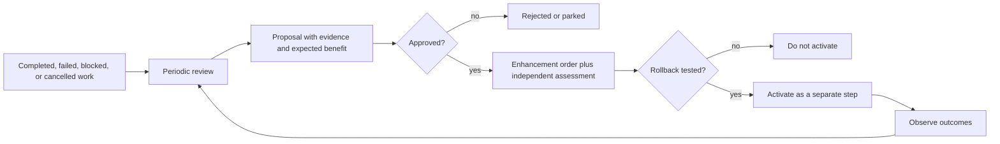

<!-- Generated from docs/src/content/docs. Do not edit directly. -->

# Self-enhancement

*Periodic review, proposals, approval, rollback, and model/category lifecycle.*

## Why the factory changes

A project starts with only the capabilities it needs. As work grows, a missing
capability or a recurring pattern becomes an enhancement proposal.

Enhancement needs are identified in two ways:

- when work is blocked or a reusable improvement is noticed during assigned
  work;
- through periodic review of completed, failed, blocked, cancelled, and
  escalated work, recurring blockers, repeated manual steps, resource data, and
  routing results.

## Review schedule

A project-configured scheduler in code creates a periodic review order.

- Trigger: the later of a configured interval (default one week) and a
  configured number of completed orders.
- Missed runs catch up once.
- Duplicate triggers debounce.
- An idle project reviews only when enough new evidence exists.
- The engineer may submit a review order directly.

A mid-tier agent executes the review as a normal order. It is not a core
command and not the recurring scheduler.

## Proposal record

An enhancement proposal records:

- identifier;
- observed evidence;
- expected benefit;
- estimated cost and risk;
- affected requirements or operations;
- reuse case;
- priority;
- authority and budget impact;
- state;
- links to source evidence.

States are `proposed`, `approved`, `scheduled`, `completed`, `rejected`, and
`superseded`.

## Evidence inputs

- completed, failed, blocked, cancelled, and escalated outcomes;
- recurring blockers and repeated manual steps;
- review and correction cost;
- routing results with model and category;
- resource data.

Recurring means at least a configured number of occurrences in a configured
window with a stable deduplication key. Missing or delayed usage is reported as
uncertain, not zero.

## Approval boundary

- Engineer approval is required unless a prior authorization explicitly covers
  scope, duration, and budget.
- Specification-change authority and implementation-change authority are
  separate grants.
- An approved enhancement cannot change the approval policy, budget
  enforcement, validation gate, audit, or rollback mechanism under the same
  grant.

## Enhancement lifecycle

1. Proposal is approved.
2. Work is scheduled as a normal order or step with acceptance criteria and an
   independent assessor.
3. The enhancing order completes under the pre-change implementation.
4. Activation is a separate step after that order terminates.
5. An implementation version is recorded for the changed component.
6. Rollback is exercised before activation.
7. If no tested rollback exists, the change is not applied automatically.

A failed validation, failed acceptance, regression against existing
conformance, or failed rollback enters a safe blocked state and escalates.

## Category and model lifecycle

Adding, merging, splitting, or retiring a category requires engineer approval
and the routing evidence threshold. Categories with no activity for the rolling
window are retirement candidates but are never removed silently.

A new model is approved before use, with a recorded benchmark or canary plan.
Provider model changes and deprecations trigger re-approval or removal.

## Related

- [Model routing and budgets](./routing.md)
- [Conformance](./conformance.md)
- [Security and audit](./security.md)

---

[Repository README](../../../README.md) · [Documentation home](../README.md) · [← Security and audit](./security.md) · [Conformance →](./conformance.md)
