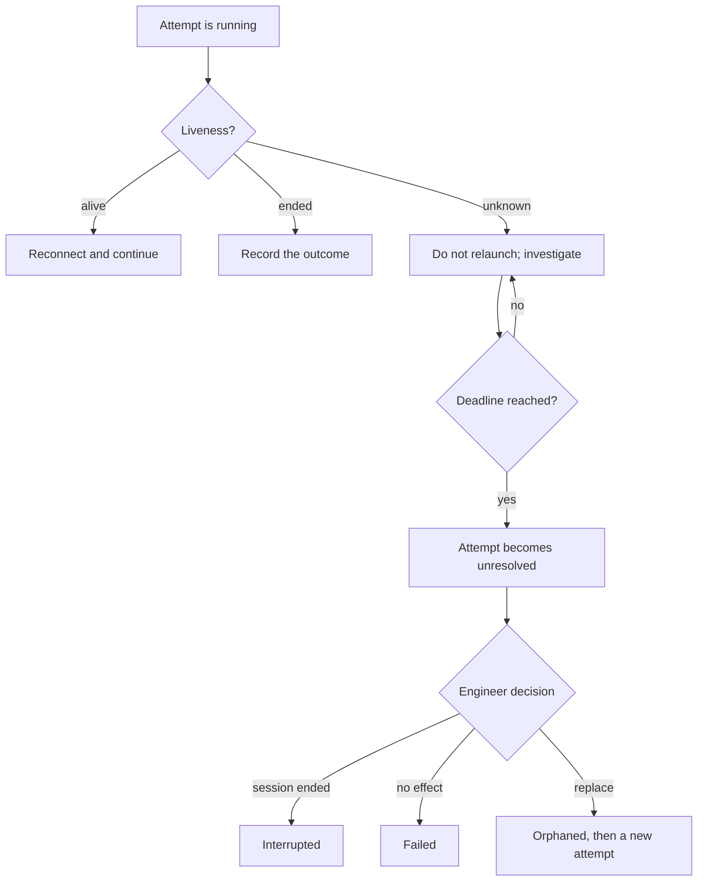

<!-- Generated from docs/src/content/docs. Do not edit directly. -->

# Execution

*Dispatch, liveness, retries, jobs, capacity, and unresolved attempts.*

Execution dispatches steps, tracks sessions, retries safe failures, and refuses
to guess when an external effect is uncertain.

## When liveness is unknown

The sections below explain dispatch, retries, jobs, capacity, and the
`unresolved` state in detail.

## Dispatch

A step is eligible when its dependencies are satisfied, budget and account
allowance are reserved, and a concurrency slot is available. Build and test
capacity is not part of step eligibility; it is admitted at job admission.

Step admission is atomic across budget, account allowance, and concurrency,
keyed by route. Job admission commits a job-level budget sub-reservation and a
capacity lease.

## Sessions and liveness

Each adapter declares a discovery capability:

- **token** — a durable attempt token is injected at launch and matched
  exactly;
- **launch-request lookup** — the retained launch identifier is resolved;
- **reference-only** — a durable session reference plus native status or attach
  check;
- **unsupported** — no discovery; only launch, status, and cancel.

Ended requires positive evidence: native terminal status, a direct lookup
returning gone or not-found, exit of the session process itself, or a completed
stop protocol.

Absence, a failed probe, a timeout, a client disconnect, a launcher-process
exit, and zero token matches are unknown.

A session lease is committed before dispatch and claimed by exactly one
session identity at adoption. The adapter refuses a second session under a
claimed lease. Each session gets a separate worktree.

## Unresolved attempts

Unknown liveness preserves the session reference and blocks replacement. At
the resolution deadline the attempt becomes `unresolved`, not interrupted.

`unresolved` means:

- the external effect may or may not have happened;
- the effect key is reserved;
- no automatic retry or replacement may launch;
- the step is blocked with an unresolved cause;
- dependents are blocked;
- a quarantine slot and budget floor are held.

The engineer resolves by:

- confirming the session ended → `interrupted`;
- confirming no effect → `failed`;
- authorizing replacement → the old attempt becomes `orphaned` and a new
  attempt is created.

A live session found after restart while unresolved is not resumed
automatically.

## Retries

Retry policy applies to step attempts. Default: three retries after the first
attempt, four attempts total, configurable from zero to ten per chain.

Only confirmed terminal failures count:

- a session confirmed ended;
- a confirmed worker loss;
- a non-allowance rate-limit refusal;
- an idempotent launch failure.

A factory-side timeout or lost response is in-doubt and goes to discovery. An
exhausted allowance is a budget blocker and consumes no retry. Unclassifiable
outcomes do not retry and escalate.

Backoff is 30 seconds, 2 minutes, 8 minutes, then capped at 10 minutes, with
20 percent clamped jitter. A provider `Retry-After` takes precedence even above
the cap.

Circuit breakers are scoped to account, harness, and model route. Three
consecutive transient failures within 10 minutes trip a breaker; cooldown is 5
minutes, then a single half-open probe.

Replanning is capped at two authorized replans per order or incident before
engineer approval.

## Jobs and capacity

A job carries identifier, kind, serving step, wiring version, inputs, required
capacity units, priority, state, attempts, timeout, cache key, artifacts, logs,
result, and timestamps.

States are queued, running, succeeded, failed, timed_out, cancelled, unknown,
and orphaned.

Admission commits intent, idempotency key, job-level budget sub-reservation,
capacity lease, and pool selection atomically before external dispatch. Workers
heartbeat; an expired lease moves the job to unknown, not failed.

Cache keys include commit, command, environment hash, toolchain or image
digest, dependency lock, test selection, wiring version, and assumption
generations. Default lifetime is seven days.

## Stall detection

The monitor detects:

- a running attempt with no activity, heartbeat, or artifact change;
- a ready and eligible step undispatched;
- an active order with no step or phase change.

Missing heartbeat is unknown, not a stall. Capacity and budget deficits are
separate blockers. Incidents persist across restarts, use debounce and
hysteresis, and are suppressed during startup reconciliation and graceful
shutdown.

Escalation is cause-routed: plan or dependency to the plan owner, wiring to the
repair agent, capacity or budget to the resource controller, liveness to
harness investigation, delivery to the delivery owner.

## Related

- [Recovery](./recovery.md)
- [Model routing and budgets](./routing.md)
- [States](../reference/states.md)

---

[Repository README](../../../README.md) · [Documentation home](../README.md) · [← Planning and dependencies](./planning.md) · [Delivery and integration →](./delivery.md)
