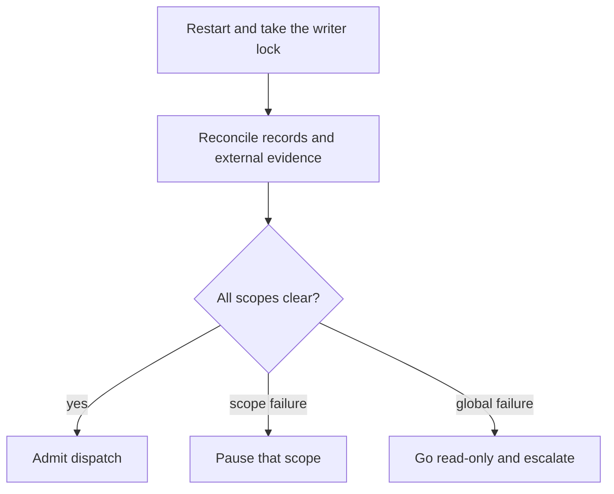

<!-- Generated from docs/src/content/docs. Do not edit directly. -->

# Recovery

*Restart reconciliation, unresolved work, leases, retries, and the recovery matrix.*

Recovery reconciles what the factory recorded with what actually happened outside
it. It does not replay history or retry uncertain effects.

## Startup in one picture

The reconciliation order and the evidence used at each stage are listed below.

## Recovery is reconciliation, not replay

On restart the factory does not replay history. It reconciles durable records
and external evidence, then resumes dispatch.

## Recovery inventory

Startup acquires the writer lock and reconciles in this order:

1. store and audit integrity;
2. configuration digest and retained snapshots;
3. plans and worktree ownership;
4. binding of effect intents and idempotency claims;
5. target delivery classification under the old epoch;
6. sessions;
7. attempts;
8. jobs;
9. deliveries and receipts;
10. retry and breaker state;
11. reservations, unresolved exposure, queue, and capacity.

Claims are bound and quarantined before evidence, then disposed after the
session, target, or job evidence that determines their outcome. No launch,
build, delivery, worktree, or retry is admitted until all stages complete and
the claim is disposed.

Scopes are global, account, route, target, order, and plan subtree. An
order-local failure pauses only that order.

## Unresolved work

Unresolved attempts keep their effect key.

- positive terminal session evidence or a confirmed stop → `interrupted`;
- engineer confirms no effect → `failed`;
- authorized replacement → `orphaned`, plus a new attempt.

The old attempt stays terminal; its lease and effect key are transferred
explicitly. A live session found after restart is not resumed automatically.
The engineer chooses stop, replacement, or acceptance after re-based
assessment.

In-flight deliveries are classified under the old epoch before re-fencing.
Applied adopts or reconstructs the receipt, not-applied releases, unknown holds
the claim. Only free or expired leases are re-fenced. A late holder is
recorded as orphaned; non-git adapters report whether the effect landed.

## Configuration digests

Attempts, jobs, deliveries, claims, leases, and retry records record the
configuration digest they started with. Content-addressed snapshots are
retained while referenced.

New work uses the active digest. Pinned work keeps its snapshot. Unresolved work
keeps its prior digest and exposure until resolved.

## Retry and breaker recovery

Retry state is an explicit record per attempt chain:

- stable timer identifier;
- effect key;
- chain generation;
- policy generation;
- counted attempts;
- remaining allowance;
- wall-clock absolute deadline;
- delay source;
- non-counting reasons.

Fire-once consumption, retry-record advance, attempt intent, idempotency claim,
and admission reservation commit atomically. The fire-once key includes effect
key, chain generation, and retry ordinal.

Restart resumes the wall-clock deadline. Downtime past it fires once during
reconciliation through the full admission gate.

Breaker state records account, harness, route, the failure-event window,
cooldown, a single half-open probe lease, and its policy generation. Breaker
reconciliation is account and route scoped.

## Recovery matrix

Crash points are derived from the durability order:

- before claim;
- after claim before intent;
- after intent before launch acknowledgement;
- after effect before outcome commit;
- after read-back before receipt commit;
- during adoption;
- during compensation;
- after outcome commit before acknowledgement;
- during reconciliation itself.

Cells cover live-session restart, unresolved restart, in-doubt delivery,
expired lease with a stale holder attempting an effect, restart during backoff,
duplicate timer fire, and duplicate request after restart.

Each cell states the expected persisted state, launch and adapter invocation
counts cross-checked against intents and receipts, expected configuration
digest, and a path-reached assertion. A negative control disables fencing and
must detect a duplicate and fail.

## Related

- [Execution](./execution.md)
- [Delivery](./delivery.md)
- [Onboarding](./onboarding.md)

---

[Repository README](../../../README.md) · [Documentation home](../README.md) · [← Delivery and integration](./delivery.md) · [Model routing and budgets →](./routing.md)
