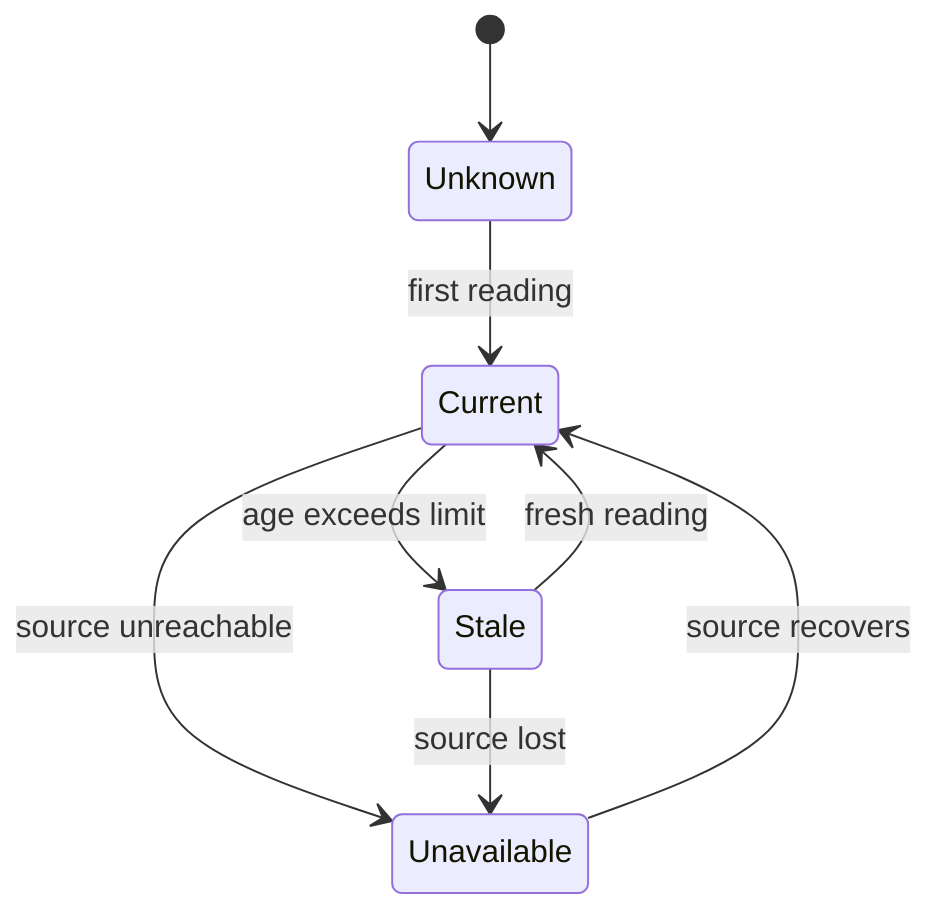

Day-to-day operation is mostly `status`, answering questions, and `shutdown`.
This page explains what each surface shows, how to read freshness, and what
happens when you stop the factory.

## The engineer surface

The core commands are `onboard`, `start`, `submit`, `status`, `answer`, and
`shutdown`. `focus` and `optimize` are optional.

The dashboard is an alternative surface for monitoring and the core actions,
not a separate authority. It exposes `submit` and `answer`. Onboard, start,
and shutdown remain CLI and onboarding surfaces.

Every exposed action uses the same operation envelope and authorization as the
CLI, with one request identifier and one effect.

## What status reports

`status` must report:

- factory state and whether dispatch is active;
- the specification version the implementation was built against;
- orders, state, and priority;
- order progress and estimated completion with confidence or explicit unknown;
- active steps with assigned agent or model and state;
- pending engineer questions, what they block, and how long they have waited;
- account usage against allowance or budget with reset windows;
- build and test queue and capacity;
- recent failed attempts, exhausted retries, and escalations.

When eligible work is not starting, status must say why: throttling, budget,
capacity, a dependency, or pending input.

Status deliberately excludes full plans, dependency graphs, historical
analytics, and drill-down views. Those belong to the dashboard.

## Facts, states, and freshness

Every fact has a value and an independent state:

- `current`
- `stale`
- `unknown`
- `unavailable`

A real zero is a value with state `current`, not a state. Precedence is
unavailable, unknown, stale, then current.

Unknown means no reading has ever been obtained. Unavailable means the source
cannot be reached. If an unavailable source recovers with no previous reading,
the fact becomes unknown. A derived fact inherits the worst state of its required
inputs. It is withheld only when no value can be produced; withholding renders
as unknown, never as silent omission.

Policy sets a maximum freshness limit per fact class. A source may declare a
shorter limit, not a longer one. Each rendered fact shows its age, limit,
source, policy version, and provenance: observed, estimated, projected,
reserved, or unresolved exposure.

## Health scopes

Health is scoped to factory, account, route, target, and order. Each scope has
a minimum required fact set.

A scope is degraded when a required fact is stale, unknown, or unavailable.
Factory health is degraded when a required global fact is bad or when every
child scope of a required kind is degraded. Total child failure cannot render
green.

## Access

The engineer may read all operational facts. An agent may read its own step and
attempt records, its order's plan and dependency states, and aggregate queue,
capacity, and budget facts. It may not read another order's prompts, evidence,
or artifacts.

An auditor may read operational facts, evidence references, and audit entries,
but not secrets, prompts, or artifact content unless separately granted, and
performs no operation.

Dashboard reads pass the same filter as CLI reads.

## Questions

When an agent needs the engineer:

- the question records its order, asker, decision key, generation, and blocking
  scope;
- only dependents of the decision are blocked;
- independent work continues.

An answer presents the expected generation. A mismatch is a conflict. An
identical answer is a no-op. Different answers for one generation are rejected
until the engineer confirms. A new answer creates a new generation and triggers
revalidation.

Before completion every open question must be answered, withdrawn, or carried
into a successor. After completion, new questions need a successor order.

## Shutdown

Graceful shutdown:

1. stops starting new steps;
2. waits a configurable grace period;
3. preserves unfinished steps and pending questions as resumable;
4. reports finished, interrupted, still-running, and awaiting-input work;
5. offers the engineer the option to wait longer.

Shutdown never discards preserved work.

## Related

- [Recovery](/guides/recovery/)
- [Security and audit](/guides/security/)
- [Commands](/reference/commands/)
