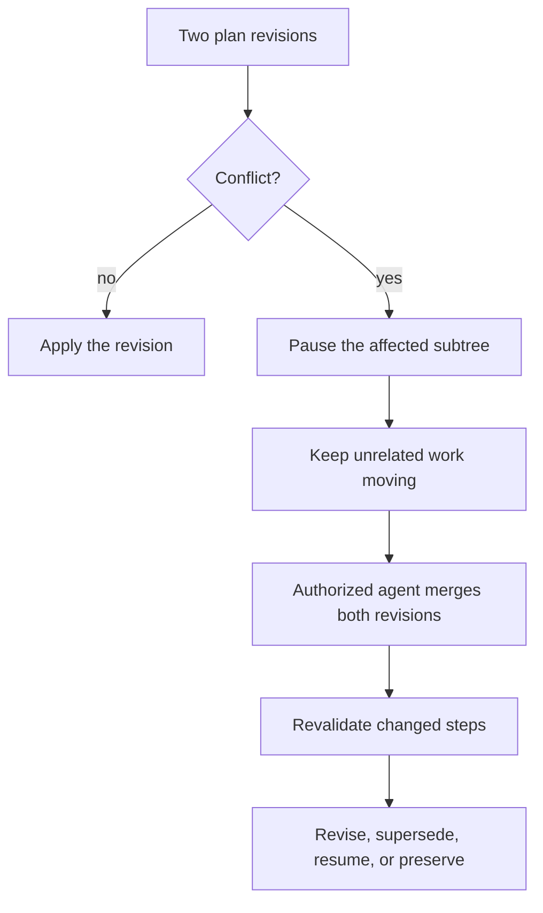

An order becomes a plan of steps with dependencies. This page explains briefs,
priorities, dependency rules, and what happens when two plan revisions conflict.

## When plan revisions conflict

The rest of this page describes the records and rules behind that flow.

## From order to plan

An order may arrive from a prompt, a specification, or both. A smart, expensive
agent plans at a broad level sufficient for a mid-tier agent to elaborate.
Mid-tier agents produce specific implementation instructions for cheap, fast
implementation agents.

This hierarchy guides delegation. It does not prescribe a fixed pipeline.

## The brief

Every delegated step gets a focused brief:

- objective;
- relevant requirements;
- specific instructions;
- expected output;
- completion criteria;
- links to the original order, applicable Piton specifications, and relevant
  prior results.

The receiving agent can consult broader context or request help. Briefs and
results are preserved so handoffs do not depend on memory.

## Priority

Priority is an integer from 0 to 100, default 50. Higher wins. Named defaults:

| Label | Value |
| --- | --- |
| Critical | 90 |
| High | 75 |
| Normal | 50 |
| Low | 25 |

Steps inherit their order's priority. A planner may lower a step or keep it
equal; a step cannot outrank its order. Raising above the order requires an
order revision.

Dispatch chooses the highest-priority ready and eligible step. Ties favor a
step with a prior attempt, then persisted ready time, then older order, then
step identifier. Running work and running jobs are never preempted.

There is no automatic aging. Priority inversion is reported, and the engineer
may reprioritize.

## Dependencies

A dependency is a directed edge with a stable identifier, a dependent, a
prerequisite, a kind, and an optional pinned revision. Edges are scoped to one
order.

- **result** — the prerequisite has an assessed result, possibly still
  unmerged.
- **integrated** — the prerequisite is merged or explicitly integrated.

Only all-of requirements are supported. Optional and any-of dependencies are
rejected with a diagnostic.

A failed, cancelled, superseded, unresolved, or missing prerequisite blocks
dependents until an authorized revision repairs or removes the edge.

Validation runs at proposal, at revision merge, and when persisted plans load.
Cycles and dangling edges pause the affected subtree, roll back to the last
valid plan, and escalate.

Writing steps declare touched paths and non-path resources. Undeclared
non-path resources deny dispatch. Cross-order overlap uses a durable
serialization lease.

## Concurrent plan revisions

Conflicting concurrent revisions are a merge conflict.

1. Identify the steps directly changed and every step whose work depends on
   their output.
2. Pause dispatch in that affected subtree.
3. Keep unrelated work moving.
4. Preserve both revisions.
5. Dispatch an authorized agent to merge them.
6. Revalidate paused steps against the merged plan.
7. Revise or supersede changed steps, resume valid ones, preserve earlier
   results for reuse.
8. Resume dispatch only after the merged plan passes checks.

If changes are compatible, both survive. If they disagree about implementation,
the resolver decides. If they disagree about what the engineer wants, it
escalates.

## Estimates

Estimates fit the level of work:

- large tasks use t-shirt sizes;
- mid-tier briefs use story points;
- cheap implementation agents estimate in time.

Agents also report progress, remaining work, and confidence. Estimates are
advisory, not commitments. The factory converts them into completion ranges
using plan progress and historical throughput, and reports unknown when evidence
is insufficient. Estimates inform reporting; they do not gate dependency
readiness, capacity, or dispatch.

## Related

- [Execution](/guides/execution/)
- [Delivery](/guides/delivery/)
- [States](/reference/states/)
