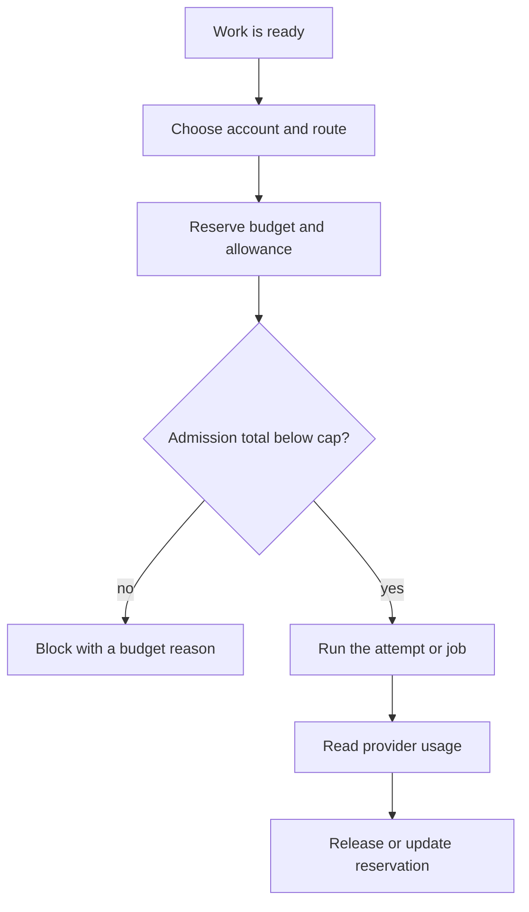

Routing picks an approved model and account, then admits work only if budget
and allowance allow it. Unknown usage is never treated as zero.

## Budget admission

Concurrency is a separate admission gate. The rest of this page covers the
ledgers, reservations, reset windows, and learned routing.

## Two ledgers

Each account has exactly one scalar ledger:

- **API account** — currency;
- **subscription account** — normalized usage units.

A subscription unit is a normalized cost unit derived from provider, model,
token class, and reset window through a versioned conversion table with an
effective date and upward rounding.

No admission total sums across ledgers. A paid fallback uses a distinct API
account or billing-mode ledger.

## Reservations

A reservation is created atomically with dispatch intent and account selection
under an account admission lock. Concurrent orders cannot both pass admission
against the same remaining amount.

- Reservations are per attempt and reconcile with actual usage.
- If actual exceeds the reservation, both are updated before new dispatch.
- Late readings reconcile idempotently.
- A reservation remains a floor until confirmed usage or an explicit engineer
  write-off.
- Expiry never frees budget for an attempt whose usage is unknown.
- The default expiry for an unconfirmed launch that never started is one hour,
  with adapter discovery or negative confirmation as proof.

## Admission total

Admission total is:

- confirmed high-water;
- plus active reservations not yet covered by observed advance;
- plus unresolved exposure;
- plus projected overrun of active attempts;
- plus an unreported-burn reserve.

The reserve is added once per account for the stale interval, not per
admission. A reservation decreases by observed advance since its dispatch
baseline. Advance allocation goes to the oldest unresolved amount first, then
active reservations; partial coverage leaves the remainder unresolved.

Readings carry a provider identity or per-account sequence and apply only when
they advance the high-water mark.

## Reset windows

Each subscription counter has a window epoch. An attempt holds its reservation
in every window it spans until the attempt closes or confirmed usage arrives.
A reset confirmation alone never releases it.

A pre-reset tail without a final reading is unresolved exposure bounded by the
burn-rate estimate. A reset requires a provider marker or the window boundary;
a downward correction is not a reset.

## Throttling and exhaustion

- 429 with an explicit exhausted discriminator → budget blocker.
- 429 with a throttling discriminator → retry and backoff; may trigger the
  paid-fallback decision.
- Ambiguous refusal with stale data → throttling with immediate refresh.
- Repeated unexplained refusals → escalate.

A pre-approved fallback policy is scoped per account, order, cap, and expiry.
Paid fallback is never automatic unless the engineer pre-approved it, and it
retains the subscription reservation until handoff is confirmed.

## Best-effort cap

The factory cap is an admission gate. No new dispatch starts when the admission
total reaches the approved cap.

Running work may continue. When projected overrun would exceed the accepted
exposure bound, the factory requests cancellation; the provider may ignore it.

The exposure bound is derived per account from concurrent attempt timeouts,
maximum burn rate, and detection and cancellation latency. A provider-enforced
ceiling is preferred and treated as hard when available. A best-effort account
asserts that dispatch stops and the ledger reconciles, not that provider spend
stays below the bound.

## Learned routing

Model routing depends on thresholds and hard limits set by the engineer. The
engineer approves the models that may be used.

Within those limits, the factory chooses models by learning from observed
results, separately for each kind of work. A particular order may override the
default preference with a different speed, quality, or economy priority.

Task categories start with workflow roles: planning, implementation, review,
integration, and research. A project may add a category with engineer approval
and sufficient evidence. Keep the set stable enough for evidence to accumulate.

## Evidence thresholds

Cold start uses an engineer-approved default model order per category.

A routing change needs a rolling evidence window, defaulting to 90 days, with:

- at least 20 accepted outcomes;
- across at least two models;
- with at least five accepted outcomes per model.

A configured exploration share, defaulting to 10 percent, routes work to a
non-preferred approved model so counterfactual evidence accumulates.

Outcome cost includes review passes and corrections. A new model is approved by
the engineer before use, with a recorded benchmark or canary plan.

## Related

- [Evolution](/guides/evolution/)
- [Operating](/guides/operating/)
- [Recovery](/guides/recovery/)
