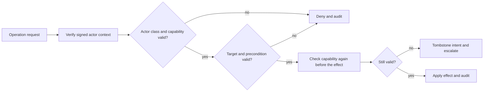

## Actor classes

- **Engineer** — may read and act across the factory.
- **Factory code** — trusted for internal controls.
- **Agent** — acts on its assigned step and work beneath it, within revision
  authority.
- **Auditor** — read-only; performs no operation.

Authentication is project-specific, but every operation is checked against the
actor classes and the authorization matrix.

## Deny by default

Authorization is a row per operation with allowed actors, target scope, and
preconditions. Examples:

| Operation | Allowed | Precondition |
| --- | --- | --- |
| Submit order | Engineer, or agent with engineer-delegation capability | Valid submission |
| Revise order | Engineer, plan owner, higher tier | Active order, aggregate version |
| Add or revise step | Plan owner, higher tier, assigned agent for own work | Active plan, plan version |
| Report outcome, help, evidence, progress | Assigned agent | Active attempt, session lease |
| Answer question | Engineer or delegated agent | Current question generation |
| Assess step | Independent assessor | Result revision, frozen criteria |
| Accept order | Independent assessor | Receipts, checks, completion assessment, no self |
| Configuration or evolution | Engineer or recorded pre-authorization | Separate grants |
| Delivery | Delivery owner, merger, integrator | Target lease, epoch, candidate revision |
| Run conformance | Independent verifier principal | Admitted independence record |
| Alter report or write code | Denied to verifier | — |

Every other combination is denied.

## Identity and capabilities

An actor identity is bound to an authenticated session or attempt through a
signed context with audience, nonce, and freshness. Session and attempt records
store role and tier. A free-text actor field is never sufficient.

A capability records issuer, operation, target, scope, expiry, and revocation.
The issuer must hold the scope; delegation cannot widen it. Capabilities are
signed and written only by factory code.

They are checked at intent commit and before every external effect. If a
capability is revoked or expires before the effect, the intent is tombstoned,
no effect occurs, and the incident escalates.

## Audit

Change audit entries commit with the change transaction. Denial and replay
entries commit in their own append-only transactions and change no operational
state beyond the audit append.

Every entry has:

- one global sequence and a sequence for its primary chain;
- actor, target, operation, outcome, request identifier, and time;
- the previous hash for the global chain and its primary chain.

Entries are hash-chained per target and globally. Checkpoints are append-only,
monotonic, independently readable, and anchored outside the writable store.
A maximum checkpoint interval bounds undetected tampering.

An unreachable anchor marks audit degraded and blocks new external effects
until it recovers; existing work continues.

A broken chain or missing sequence blocks the affected target or the whole
factory when the global chain is affected. The incident is recorded outside the
broken chain where possible. Recovery quarantines the affected scope and never
rewrites history.

## Read scopes

- Engineer: all operational facts.
- Agent: own step and attempt records, own order plan and dependencies,
  aggregate queue, capacity, and budget facts. Not another order's prompts,
  evidence, or artifacts.
- Auditor: operational facts, evidence references, and audit entries. Not
  secrets, prompts, or artifact content unless separately granted. No actions.

## Verification

A conformance verifier is a distinct authenticated principal, not merely a new
session. The excluded set is recorded before the run: scaffold author, descriptor
and configuration author, onboarding author, plan author, implementers,
assessor, delivery owner, merger, and integrator.

The verifier may append one report. It may not alter an existing report, write
implementation code, or write configuration. The engineer cannot waive
independence.

## Related

- [Conformance](/guides/conformance/)
- [Onboarding](/guides/onboarding/)
- [Operating](/guides/operating/)
