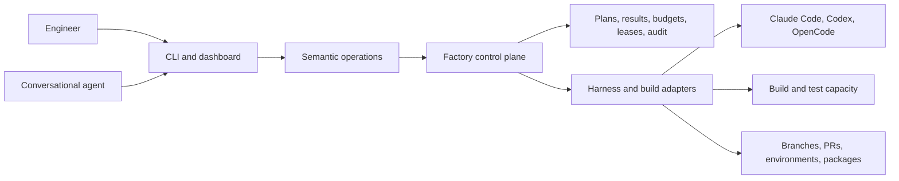

The factory is a way to hand a whole piece of work to your AI tools instead of
prompting them one step at a time.

You describe what you want. The factory turns that into a plan, gives the
pieces to agents, checks the results, and delivers the changes. You can watch
what is happening, answer questions, and stop or resume safely.

This site explains:

- **how it works**, in plain language;
- **how to set it up** in a new or existing project;
- **how to use it** day to day;
- **the rules behind it**, if you need to implement or verify one.

## Start here

1. [Getting started tutorial](/tutorial/)
2. [How it works](/start/how-it-works/)
3. [Set up in a new project](/start/setup/)
4. [First run](/start/quickstart/)

If you already know how it works and just want the setup steps, use the
[setup guide](/start/setup/). If you are new, start with the tutorial.

## What the factory is not

It is not a hosted service you sign up for. It is a specification your project
adopts and implements in its own codebase, using its own accounts, models, and
delivery targets.

The package gives you the rules and the agent skills. Your project provides the
implementation and the credentials.
