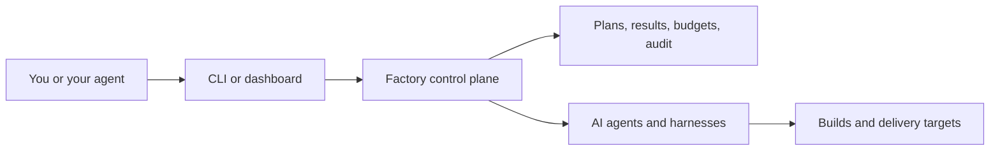

The factory is a way to hand a whole piece of work to your AI tools instead of
prompting them one step at a time.

You describe what you want. The factory turns that into a plan, gives the pieces
to agents, checks the results, and delivers the changes. You can watch what is
happening, answer questions, and stop or resume safely.

This site explains:

- **how it works**, in plain language;
- **how to set it up** in a new or existing project;
- **how to use it** day to day;
- **the rules behind it**, if you need to implement or verify one.

## How the pieces fit

The factory is the control plane. It owns scheduling, budgets, retries,
recovery, and evidence. Agents do the work. Your project supplies the accounts,
adapters, and delivery targets.

## Choose your path

| If you want to... | Start here |
| --- | --- |
| See a working factory end to end | [Getting started tutorial](/tutorial/) |
| Understand the idea first | [How it works](/start/how-it-works/) |
| Set up a project | [Set up in a new project](/start/setup/) |
| Run one order now | [First run](/start/quickstart/) |
| Operate it day to day | [Operating a factory](/guides/operating/) |
| Understand the tradeoffs | [Design choices](/start/choices/) |
| Implement or verify one | [Core concepts](/start/concepts/) and the [reference](/reference/commands/) |

## How the documentation is organized

The documentation follows the life of an order and the guarantees behind it.

| Section | What it covers |
| --- | --- |
| [Tutorial](/tutorial/) | Install, scaffold, onboard, and deliver one order step by step |
| [How it works](/start/how-it-works/) | The idea and the concepts behind the factory |
| [Guides](/guides/operating/) | One page per lifecycle concern: planning, execution, delivery, recovery, routing, security |
| [Reference](/reference/commands/) | The exact commands, states, operations, and descriptor schema |

## What you get

- a repeatable way to turn an order into planned, delegated work;
- independent checks before work counts as complete;
- durable records, so work survives restarts and can be audited;
- explicit budget, capacity, and approval limits;
- safe answers for the cases where guessing would be dangerous.

## What the factory is not

It is not a hosted service you sign up for. It is a specification your project
adopts and implements in its own codebase, using its own accounts, models, and
delivery targets.

The package gives you the rules and the agent skills. Your project provides the
implementation and the credentials.

If you are new, start with the [tutorial](/tutorial/). If you want the reasoning
behind the design, read [Why a factory](/start/why/).
