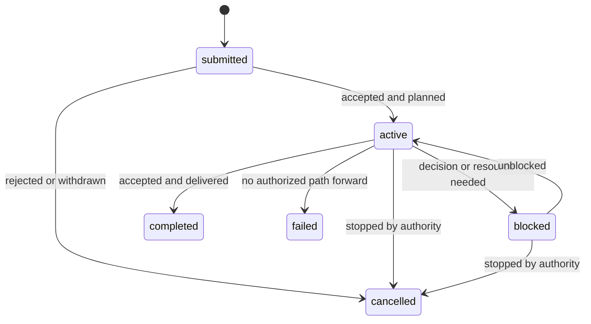
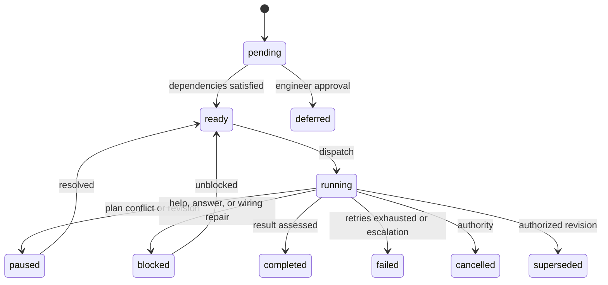
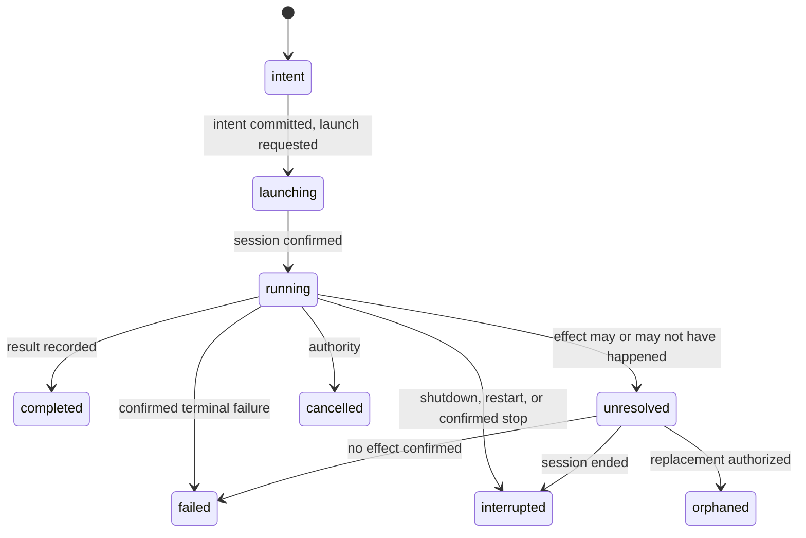

These are the state machines an implementation must represent. The tables are
authoritative. The diagrams show the common paths; they do not list every
implementation detail.

| Machine | Main values |
| --- | --- |
| Order | submitted, active, blocked, completed, failed, cancelled |
| Step | pending, ready, running, paused, blocked, completed, failed, cancelled, superseded, deferred |
| Attempt | intent, launching, running, completed, failed, interrupted, unresolved, cancelled, orphaned |
| Session liveness | alive, ended, unknown |

## Order states

`completed`, `failed`, and `cancelled` are terminal.

| State | Meaning |
| --- | --- |
| `submitted` | Accepted, no work started |
| `active` | Factory can make progress |
| `blocked` | Progress needs an external decision or resource |
| `completed` | Required work accepted and delivered |
| `failed` | Terminal, no authorized path forward |
| `cancelled` | Terminal, by code or engineer authority |

Precedence: cancelled, failed, completed, blocked, active, submitted.

Order phases:

| Phase | Meaning |
| --- | --- |
| `planning` | A plan is being produced or repaired |
| `executing` | Steps are being dispatched or run |
| `integrating` | Combined changes are being integrated |
| `delivering` | External delivery is in progress |
| `assessing` | Completion is being assessed |

Phase precedence: assessing, delivering, integrating, executing, planning.
Phase is null for submitted and terminal orders.

## Step states

`completed`, `failed`, `cancelled`, `superseded`, and `deferred` are terminal.

| State | Meaning |
| --- | --- |
| `pending` | At least one dependency unmet |
| `ready` | Eligible for dispatch |
| `running` | Active attempt or completed attempt awaiting assessment |
| `paused` | Plan conflict or revision holds the subtree |
| `blocked` | Awaiting help, an engineer answer, or wiring repair |
| `completed` | Attempt completed and required assessment passed |
| `failed` | Terminal after retries or escalation |
| `cancelled` | Terminal by authority |
| `superseded` | Terminal by authorized revision |
| `deferred` | Terminal only with engineer approval |

A step becomes cancelled or superseded only after its attempt is terminal.
Until then it stays running with a cancelling blocker. A failed, cancelled,
superseded, or unresolved prerequisite blocks dependents.

## Attempt states

`completed`, `failed`, `interrupted`, `cancelled`, and `orphaned` are terminal.

| State | Meaning |
| --- | --- |
| `intent` | Persisted before launch |
| `launching` | Launch requested, session not yet confirmed |
| `running` | Session active |
| `completed` | Finished with a result |
| `failed` | Terminal failure |
| `interrupted` | Shutdown, restart, or confirmed stop |
| `unresolved` | Effect may or may not have happened |
| `cancelled` | Terminal by authority |
| `orphaned` | Terminal, replaced after engineer authorization |

`unresolved` never returns to running. It transitions to interrupted, failed,
or orphaned under explicit evidence or authority.

## Session liveness

| State | Meaning |
| --- | --- |
| `alive` | Positive evidence of a live session |
| `ended` | Positive terminal evidence |
| `unknown` | No positive evidence either way |

Absence, a failed probe, a timeout, a client disconnect, and zero token matches
are unknown.

## Job states

`queued`, `running`, `succeeded`, `failed`, `timed_out`, `cancelled`,
`unknown`, `orphaned`.

## Delivery outcomes

`pending`, `running`, `succeeded`, `partial`, `failed`, `unresolved`,
`unnecessary`.

## Observability fact states

`current`, `stale`, `unknown`, `unavailable`.

A real zero is a value, not a state. Precedence: unavailable, unknown, stale,
current.

## Related

- [Core concepts](/start/concepts/)
- [Execution](/guides/execution/)
- [Delivery](/guides/delivery/)
