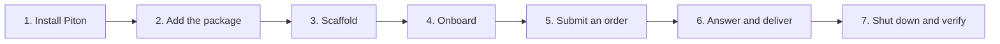

This tutorial takes you from an empty project to a factory that can accept one
small order, show what it is doing, ask you a question, deliver the result, shut
down, resume, and pass a conformance check.

It is intentionally hand-held. Each lesson ends with a checkpoint. Do not skip
a checkpoint; the next lesson assumes it passed.

## What you will build

A project-owned factory with:

- a valid `.factory/project.json`;
- all six core commands;
- a minimal dashboard;
- an approved operating policy;
- one small order delivered with receipts;
- a shutdown and resume that preserve work;
- an admissible conformance report.

## What you need

- a project in git;
- the Piton CLI;
- an AI coding agent such as Claude Code, Codex, or OpenCode;
- at least one agent account or subscription;
- a delivery destination: a branch, pull request, environment, or package.

## Time

Plan for 30–60 minutes, plus time to install Piton or create accounts. The first
onboarding often takes longer because you are deciding budgets and limits.

## How to use this tutorial

Do the lessons in order:

1. [Install Piton](/tutorial/01-install-piton/)
2. [Add the factory package](/tutorial/02-add-factory/)
3. [Scaffold the factory](/tutorial/03-scaffold/)
4. [Onboard](/tutorial/04-onboard/)
5. [Submit your first order](/tutorial/05-first-order/)
6. [Answer and deliver](/tutorial/06-answer-deliver/)
7. [Shut down and verify](/tutorial/07-shutdown-verify/)

If you get stuck, each lesson has a short “if it fails” section. The
[troubleshooting section in the setup guide](/start/setup/#common-problems) has
more detail.

## A note about commands

The tutorial uses `factory` as the command. Your project may use a different
invocation. The real command is always in `.factory/project.json` under
`invocation`.

## A note about agents

The tutorial asks your coding agent to use packaged skills by name. If your
agent lists skills differently, search for “factory” in its skill list. The
skill names are stable:

- `factory-0010-scaffold`
- `factory-0010-onboard`
- `factory-0010-start`
- `factory-0010-shutdown`
- `factory-0010-verify`

You can always type the plain-language request shown in the lesson instead.
